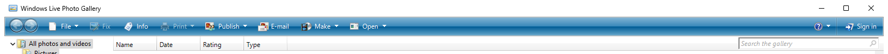
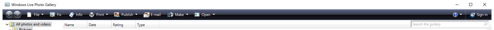

# Dark toolbar for Windows Live Photo Gallery 2008

Build 12.0.1329.0201. Three DLLs are patched, nothing is recompiled.

Before:

After:

## Build it yourself

Clone the repository and run:

    .\build.ps1

Nothing else to download: the original Microsoft installer is in `original/`. The script
checks its SHA-256 and Microsoft signature, unpacks it, applies the patch and prints the
hashes of the changed files. It needs only PowerShell. The result goes to `out/`; install it
with `msiexec /i`.

The installer comes from the
[Internet Archive](https://archive.org/details/windows-live-photo-gallery), SHA-256
`c273c4e5f99cc1bab911b4e5373201739e33c00425131cfc16f77351bfb04c32`. The same page has
`SQLServerCE31-EN.msi`, the SQL Server Compact 3.1 runtime that Photo Gallery 2008 needs.

## Files

- `build.ps1` - builds the patched installer from the original MSI
- `original/` - the original Microsoft installer
- `release/wlpg-dark-toolbar/` - patched DLLs and `install.cmd`
- `unpacked/` - original files
- `scripts/patch_wlpg_toolbar.py` - the patcher
- `shots/` - before and after

Tags: `baseline` (original), `wlpg-dark-toolbar-v1` (patched).
